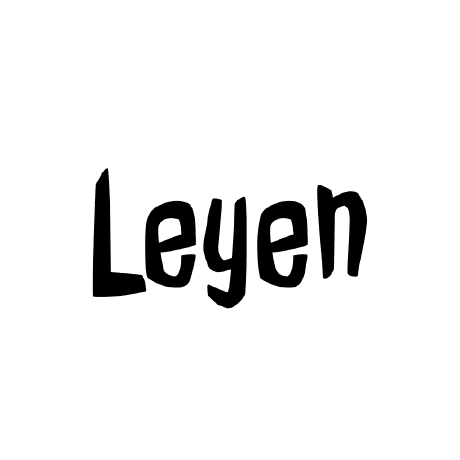

<div align="center">
<a href="https://leyen.me"></a>
</div>

<div align="center">
<h1>leyen.me</h1>
<p>Personal portfolio — built with Next.js, Sanity CMS, and Tailwind CSS</p>
</div>

<p align="center">
  <a href="https://leyen.me"><strong>Live Site</strong></a> ·
  <a href="https://leyen.me/admin"><strong>Studio</strong></a>
</p>

<br/>

## Overview

A modern personal website featuring:

- **Blog** — Markdown-powered articles with syntax highlighting and table of contents
- **Projects** — Portfolio showcase with live previews and source links
- **Quotes** — Curated collection organised by content type
- **Interviews** — Q&A-style interview archive with category filtering
- **Movies** — Personal movie watchlist with genre filtering
- **Resume** — Downloadable résumé with a custom-printed template mode
- **Password Vault** — Encrypted, slide-captcha-protected credential manager
- **Photos** — Image showcase page
- **3D Hero** — Interactive WebGL (Three.js / React Three Fiber) hero section
- **Admin Panel** — Full CRUD admin dashboard for managing all content types, plus AI-powered writing assistance (slug generation, content drafting, markdown preview)

<br/>

## Tech Stack

| Layer            | Technology                                                   |
| ---------------- | ------------------------------------------------------------ |
| **Framework**    | [Next.js 14](https://nextjs.org) (App Router, RSC, Server Actions) |
| **CMS**          | [Sanity.io](https://sanity.io) — headless content lake       |
| **Styling**      | [Tailwind CSS 3](https://tailwindcss.com) + [Framer Motion](https://framer.com/motion) |
| **3D Graphics**  | [Three.js](https://threejs.org) / [React Three Fiber](https://r3f.docs.pmnd.rs) / [Drei](https://github.com/pmndrs/drei) |
| **Auth**         | [iron-session](https://github.com/vvo/iron-session) — encrypted session cookies |
| **Theme**        | [next-themes](https://github.com/pacocoursey/next-themes) — dark/light mode |
| **Database**     | Sanity (for content), local encrypted storage (for password vault) |
| **Deployment**   | [Vercel](https://vercel.com)                                  |
| **Assets**       | Custom fonts (Incognito, Gitlab Mono), custom SVG icons       |

<br/>

## Getting Started

### Prerequisites

- Node.js 18+
- A [Sanity.io](https://sanity.io) account

### Clone & Install

```bash
git clone https://github.com/leyen-me/leyen.me.git
cd leyen.me
npm install
```

### Configure Environment

Copy the example env file:

```bash
cp .env.example .env.local
```

You'll need the following Sanity credentials:

| Variable                          | Description                    |
| --------------------------------- | ------------------------------ |
| `NEXT_PUBLIC_SANITY_PROJECT_ID`   | Your Sanity project ID         |
| `NEXT_PUBLIC_SANITY_DATASET`     | Dataset name (e.g. `production`) |
| `NEXT_PUBLIC_SANITY_API_VERSION`  | API version in `YYYY-MM-DD` format |
| `SANITY_API_ACCESS_TOKEN`         | (Optional) API access token |

### Set Up Sanity

```bash
npm create sanity@latest -- --template clean --create-project "My Portfolio" --dataset production
```

After setup, copy the `projectId` from the generated `sanity.config.ts` into your `.env.local`.

### Run

```bash
npm run dev
```

Visit **http://localhost:3000** for the frontend, and **http://localhost:3000/admin** for the Sanity Studio.

> The UI starts blank. Use the admin panel to create your own content.

<br/>

## Project Structure

```
app/                  — Next.js App Router pages and API routes
├── admin/            — Admin dashboard, Sanity Studio mounting
├── api/              — API routes (admin CRUD, auth, AI, upload, revalidate)
├── blog/             — Blog listing and post pages
├── components/       — React components (global, shared, page-specific)
├── data/             — Static data (social links, graph theme)
├── interviews/       — Interview archive and detail pages
├── movies/           — Movie watchlist page
├── password/         — Encrypted password vault
├── photos/           — Photo gallery page
├── projects/         — Project listing and detail pages
├── quotes/           — Quote collection page
├── resume/           — Résumé page and print template
└── styles/           — Global CSS and Prism theme

lib/                  — Business logic, Sanity queries, utilities
schemas/              — Sanity content type schemas
components/ui/        — Reusable UI primitives (shadcn-style)
public/               — Static assets (images, 3D models)
types/                — TypeScript type definitions
```

<br/>

## Scripts

| Command             | Description                               |
| ------------------- | ----------------------------------------- |
| `npm run dev`       | Start Next.js development server          |
| `npm run build`     | Lint then build for production            |
| `npm run start`     | Start production server                   |
| `npm run migrate:pt-to-md` | Migrate Portable Text to Markdown  |

<br/>

## Key Features

### Admin Dashboard

Full CRUD management for posts, projects, interviews, movies, quotes, jobs, authors, and profile. Includes AI-powered tools for:

- Content drafting and rewriting
- Slug generation
- Markdown preview

### Password Vault

A slide-captcha-protected, locally encrypted password manager. Credentials are encrypted with AES-256-GCM before being stored.

### 3D Hero

An interactive 3D scene on the homepage using React Three Fiber and a Tesla Cybertruck GLB model.

### Blog

Articles written in Markdown with GFM support, syntax highlighting via Refractor, reading time estimation, and a sticky table of contents.

<br/>

## License

This project is [MIT](./LICENSE) licensed. You're free to use it as inspiration or directly — just link back to [leyen.me](https://leyen.me) in the footer as attribution.
